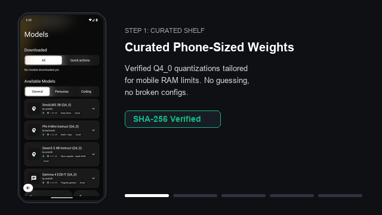
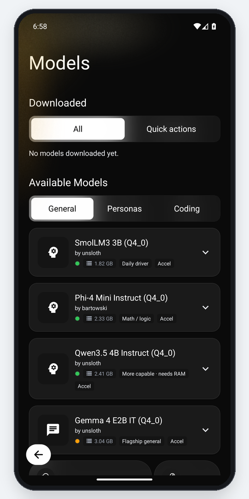
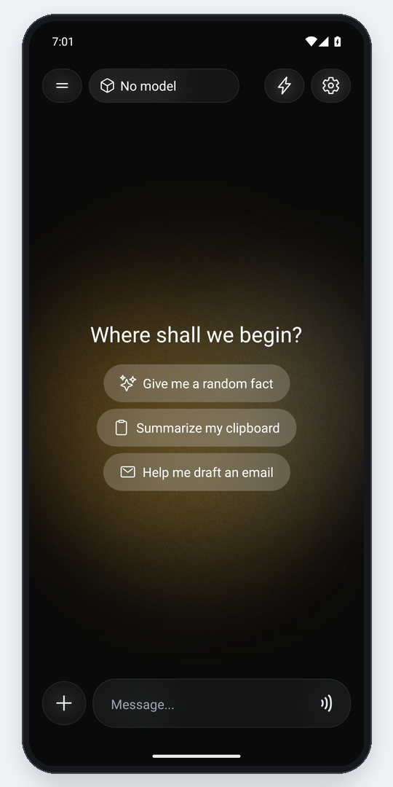
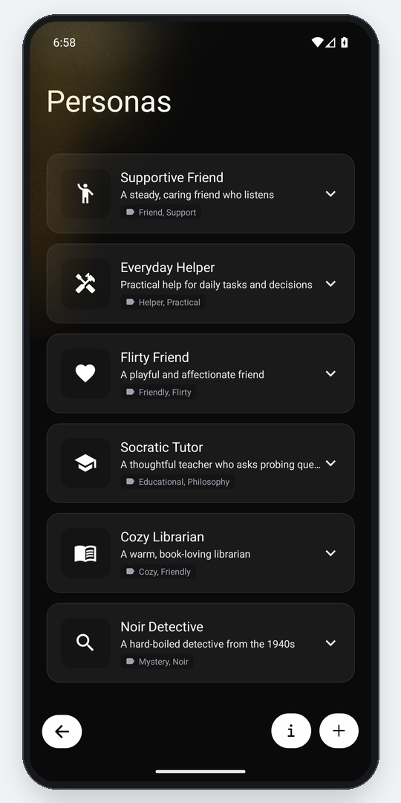
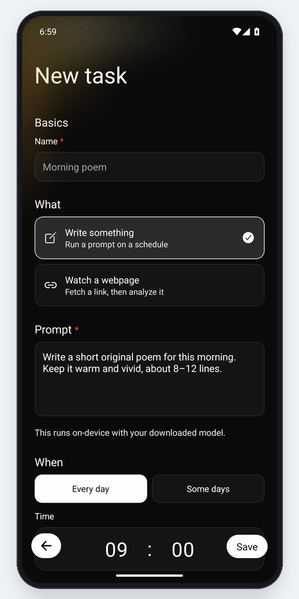
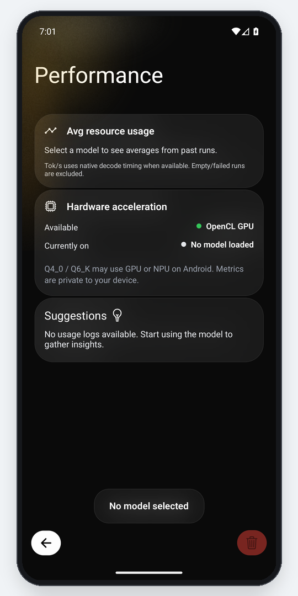
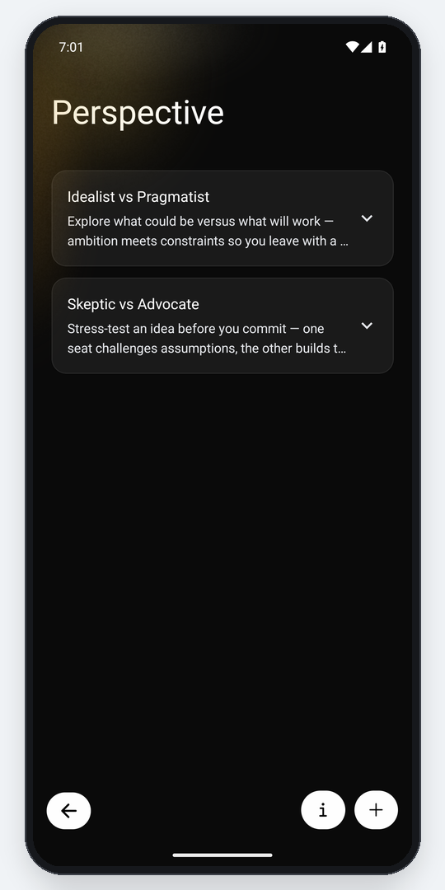

# ofln™

A private AI that runs fully offline on your phone, with no account and no cloud.

<p align="center">
  
  <br />
  <em><strong>Demo:</strong> On-device LLM workflow from curated shelf to 100% offline private execution.</em>
</p>

---

### 📲 Download & Platform Status

<p align="left">
  <a href="https://github.com/Darwin27264/ofln/releases/latest">
    
  </a>
  <a href="https://apps.obtainium.imranr.dev/add?r=https://github.com/Darwin27264/ofln">
    
  </a>
  <a href="docs/DISTRIBUTION.md#2-f-droid-official-inclusion--build-flavor-configuration">
    
  </a>
  <a href="LICENSE">
    
  </a>
</p>

> ### [⬇️ **Download Latest APK**](https://github.com/Darwin27264/ofln/releases/latest)
> Grab the latest installable Android package directly from [GitHub Releases](https://github.com/Darwin27264/ofln/releases/latest) or install and auto-update via [Obtainium](https://apps.obtainium.imranr.dev/add?r=https://github.com/Darwin27264/ofln). SHA-256 checksums are published in `SHA256SUMS.txt`.

| Platform | Channel | Status | How to Install |
|:---|:---|:---|:---|
| **Android** | **Obtainium** (Recommended) | 🟢 **1-Tap Auto-Update** | Tap [Install via Obtainium](https://apps.obtainium.imranr.dev/add?r=https://github.com/Darwin27264/ofln) to track and auto-update releases directly. |
| **Android** | **Direct APK** | 🟢 **APK Available** | Download [`ofln-release.apk`](https://github.com/Darwin27264/ofln/releases/latest) on any 64-bit ARM device (Android 7.0+ / API 24+). |
| **Android** | **F-Droid** | 🟡 **Recipe Ready** | Pure FOSS build without proprietary blobs (`metadata/com.ofln.yml`). See [DISTRIBUTION.md](docs/DISTRIBUTION.md). |
| **iOS** | **Source / TestFlight** | 🟡 **Build from Source** | Build from source with Xcode on macOS (see [Setup](#setup)). TestFlight preparation documented in [DISTRIBUTION.md](docs/DISTRIBUTION.md). |

---

## Why ofln

Most mobile AI apps are thin wrappers around remote cloud APIs that log your prompts, track your habits, and require paid subscriptions. **ofln** is different: it executes open-weights GGUF models directly on your phone's processor using [llama.cpp](https://github.com/ggerganov/llama.cpp) via [`llama.rn`](https://github.com/mybigday/llama.rn).

Here is what sets ofln apart:

- **Automated Scheduled Tasks & Source Monitor:** Schedule recurring local LLM prompts, or have ofln fetch a webpage URL (like news or documentation) and generate an executive summary entirely on-device on a timer. Raw data and summaries never leave your phone.
- **Perspective Debates:** Pit multiple AI personas against each other in structured, multi-turn debates (e.g., Pragmatist vs. Skeptic) to explore complex questions from opposing angles.
- **AI Personas Library:** Create custom system identities, adjust tone and thinking style, and isolate context per persona.
- **On-Device PDF & Image OCR:** Attach photos or documents; ofln uses local on-device OCR (ML Kit) to extract text before passing it to the model—never streaming your photos to an external vision API.
- **Voice Input & Spoken Replies:** Talk directly to your local model with speech-to-text input and listen to replies via text-to-speech output.
- **Curated Shelf of Phone-Sized Models:** No guessing which weights fit your hardware. The **Start here** shelf recommends verified Q4_0 quantized models tailored to phone RAM limits with SHA-256 integrity verification, plus full Hugging Face search and local GGUF file imports.

---

## Screenshots

<div align="center">
  <table>
    <tr>
      <td align="center" width="50%">
        
        <br />
        <strong>Curated starter shelf with phone-sized Q4_0 models & RAM badges</strong>
      </td>
      <td align="center" width="50%">
        
        <br />
        <strong>Private on-device chat with ambient hue & quick action chips</strong>
      </td>
    </tr>
    <tr>
      <td align="center" width="50%">
        
        <br />
        <strong>Personas library with custom system identities and prompts</strong>
      </td>
      <td align="center" width="50%">
        
        <br />
        <strong>Source Monitor: automated webpage fetch and on-device summary</strong>
      </td>
    </tr>
    <tr>
      <td align="center" width="50%">
        
        <br />
        <strong>Hardware acceleration monitor & OpenCL GPU backend verification</strong>
      </td>
      <td align="center" width="50%">
        
        <br />
        <strong>Perspective debate between AI personas conversing turn-by-turn</strong>
      </td>
    </tr>
  </table>
</div>

> ### 📷 Production Screen Captures
> Captured directly from a Google Pixel 8 running the release build on Android:
> 1. [x] **Model Shelf (`01_model_shelf.png`):** Curated phone-sized models with RAM guidance & SHA-256 verification.
> 2. [x] **Private Chat (`02_chat_screen.png`):** On-device inference with ambient hue and prompt suggestions.
> 3. [x] **Personas Library (`03_personas.png`):** Custom system prompts and persona identities.
> 4. [x] **Source Monitor (`04_scheduled_tasks.png`):** Automated webpage monitoring and recurring analysis setup.
> 5. [x] **Hardware Performance (`05_performance_stages.png`):** Hardware backend detection with OpenCL acceleration.
> 6. [x] **Perspective Debates (`06_perspectives.png`):** Multi-seat AI persona debate configuration (*Idealist vs. Pragmatist*).

---

## Features

- **Hugging Face Hub:** Browse and download GGUF models directly (optional token for gated repos, stored securely in Keychain).
- **Curated Starter Shelf & RAM Tiering:** Verified Q4_0 phone-friendly picks with SHA-256 integrity verification and "Recommended for your phone" badges.
- **Download Management:** Resumable downloads with percentage, live transfer rate, and ETA calculation.
- **Local File Import:** Import any `.gguf` file stored on device storage; configure temperature, context window, and GPU acceleration.
- **Streaming Inference & Context Rollup:** Native token streaming via `llama.cpp` with `<think>` reasoning block parsing, live tok/s metrics, and automatic context rollup when fullness approaches limits.
- **Share Sheet & Text Actions ("Ask ofln"):** Highlight text anywhere to summarize, rephrase, fix grammar, translate, or draft replies offline.
- **Scheduled Tasks & Morning Brief:** Periodic LLM prompts or Source Monitor (webpage fetching & offline summarization) with one-tap Morning Brief preset.
- **Perspective Debates:** Multi-speaker round-robin discussions between AI personas.
- **Hardware Acceleration & Benchmarking:** OpenCL/Hexagon backend detection with in-app inference benchmarking (prompt tok/s, generation tok/s, TTFT, peak RAM).
- **Personas & Chat Management:** Custom personas, temporary chats, conversation pinning, and renaming.
- **Document & Image Attachments:** On-device OCR and document text extraction prior to prompting.
- **Voice Input & TTS:** Local speech recognition input and spoken text playback.
- **Appearance:** High-contrast light and dark themes with ambient hue accents.
- **Usage & Performance (Stages):** Private, on-device metrics tracking token speeds and memory utilization.
- **Durable Backup & Restore:** Export chats as JSON or full profile as ZIP; restore seamlessly without exporting tokens or GGUF files.
- **Safe Mode & Sanitized Diagnostics:** Automatic crash recovery and local-only, telemetry-free sanitized diagnostic logs for privacy-preserving bug reports.

---

## Requirements

| Requirement | Notes |
|-------------|--------|
| **Node.js** | ≥ 18 |
| **JDK** | JDK 17+ (prefer 21) for Android builds (Gradle 8.12). Set `JAVA_HOME`. |
| **Android Studio / SDK** | Android NDK `27.1.12297006` and CMake 3.22.1+ |
| **Xcode & CocoaPods** | iOS builds (macOS only) |
| **New Architecture** | Enabled in project configs (required by `llama.rn`) |

---

## Setup

```bash
git clone https://github.com/Darwin27264/ofln.git
cd ofln
cp android/gradle.properties.example android/gradle.properties
npm install
```

**iOS (macOS):**

```bash
cd ios
bundle install
bundle exec pod install
cd ..
```

**Run Development Build:**

```bash
npm start          # Start Metro bundler
npm run android    # Launch on Android emulator or connected device
npm run ios        # Launch on iOS simulator or device
```

*Note: No cloud LLM API keys are required. Optional Hugging Face tokens are stored in the device Keychain and used only for gated downloads on `huggingface.co`. See [`docs/PRIVACY.md`](./docs/PRIVACY.md).*

---

## Privacy (Summary)

| Destination | Details |
|---|---|
| **Leaves Device** | Only when downloading or browsing models from Hugging Face, or fetching user-specified URLs in Source Monitor tasks. |
| **Stays Local** | All chats, prompts, model weights, personas, task schedules, OCR processing, and performance metrics. |
| **Never Exported** | Hugging Face tokens and downloaded GGUF weights are excluded from backup archives. |

Inference never communicates with an ofln cloud server. There are no tracking scripts, analytics, or user accounts.

---

## Backup & Restore

**Navigation:** Settings → Storage

| Action | Format | Description |
|---|---|---|
| **Export Chats** | `ofln-chats-*.json` | Exports chat conversations and message history. |
| **Export Full Backup** | `ofln-backup-*.zip` | Exports chats, personas, perspective presets, tasks, and settings. |
| **Import** | JSON or ZIP | Restore data by merging with existing data or replacing it. |

*Full backups do not bundle heavy GGUF files or API tokens. Models re-download on restore via catalog metadata.*

---

## Development & Build Scripts

| Script | Command | Purpose |
|---|---|---|
| **Start Metro** | `npm start` | Launches Metro bundler. |
| **Run Android** | `npm run android` | Builds and installs debug app on Android device/emulator. |
| **Run iOS** | `npm run ios` | Builds and installs debug app on iOS device/simulator. |
| **Unit Tests** | `npm test` | Runs Jest unit test suite (`__tests__/`). |
| **Lint CI** | `npm run lint:ci` | Runs ESLint on critical service and guard paths. |
| **Typecheck** | `npm run typecheck` | Checks critical path TypeScript types. |
| **Full Typecheck** | `npm run typecheck:full` | Runs project-wide `tsc --noEmit`. |
| **Build Release APK** | `npm run android:build-release` | Assembles all release APKs via Gradle (`assembleRelease`). |
| **Build FOSS Release** | `npm run android:build-foss` | Pure FOSS APK for F-Droid without Google ML Kit blobs (`assembleFossRelease`). |
| **Build Play Release** | `npm run android:build-play` | Standard release APK with on-device ML Kit OCR (`assemblePlayRelease`). |
| **Extract Release APK** | `npm run android:extract-release` | Copies release APK to `releaseAPK/ofln_{date}.apk`. |

**Direct Windows PowerShell Build Commands:**
```powershell
# Build F-Droid compliant pure FOSS release APK:
cd android; .\gradlew.bat assembleFossRelease; cd ..

# Build standard Play release APK:
cd android; .\gradlew.bat assemblePlayRelease; cd ..

# Extract release APK:
powershell -ExecutionPolicy Bypass -File .\scripts\extract-release-apk.ps1
```

---

## Project & Documentation

Created and maintained by **Evolvyn AI** (Darwin Chen).

| Document | Purpose |
|---|---|
| [`CONTRIBUTING.md`](./CONTRIBUTING.md) | Development setup, code guidelines, and pull request workflow |
| [`NOTICE`](./NOTICE) | Project copyright statement and licensing notice |
| [`docs/PRIVACY.md`](./docs/PRIVACY.md) | Deep dive on local data boundaries, tokens, and storage |
| [`docs/TECHNICAL.md`](./docs/TECHNICAL.md) | Architecture, inference pipeline, memory ladders, and 16KB pages |
| [`docs/DISTRIBUTION.md`](./docs/DISTRIBUTION.md) | Store readiness, F-Droid / IzzyOnDroid criteria, and Play Store / TestFlight steps |
| [`DESIGN.md`](./DESIGN.md) | Design tokens, typography, monochrome palette, and motion guidelines |
| [`docs/DEVICE_SMOKE.md`](./docs/DEVICE_SMOKE.md) | Maintainer device smoke checklist |
| [`TRADEMARK.md`](./TRADEMARK.md) | Trademark guidelines and fork rebranding policy |
| [`SECURITY.md`](./SECURITY.md) | Vulnerability disclosure policy |

---

## Contributing

Contributions are warmly welcomed! Please see [`CONTRIBUTING.md`](./CONTRIBUTING.md) for step-by-step setup, guidelines, and available starter issues in [`docs/issues/`](./docs/issues/).

---

## Support

ofln is free and open source. If it saves you time or data, your support is deeply appreciated:

- [GitHub Sponsors](https://github.com/sponsors/Darwin27264)
- [Ko-fi](https://ko-fi.com/darwin27)

---

## License

GNU General Public License v3.0 — see [`LICENSE`](./LICENSE) and [`NOTICE`](./NOTICE).

Copyright © 2026 Darwin Chen / Evolvyn AI.

*Third-party libraries (including llama.cpp and llama.rn) retain their upstream licenses; GPLv3 applies to this project's combined distribution terms.*

---

## Trademark & Security

- **Trademark:** **ofln™** and associated branding are trademarks of Evolvyn AI. Forks that redistribute modified binaries must rebrand. See [`TRADEMARK.md`](./TRADEMARK.md).
- **Security:** Report vulnerabilities privately according to [`SECURITY.md`](./SECURITY.md).
